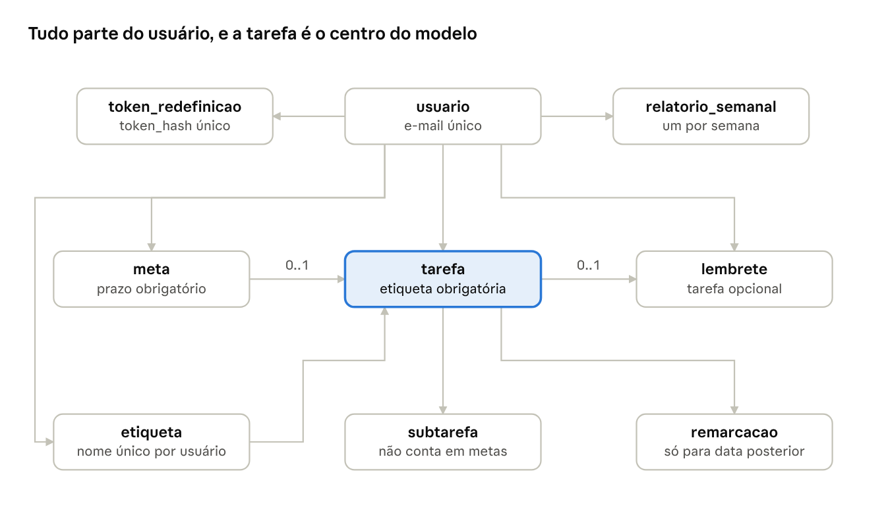

# DGD-BD-001 — Modelo de Dados — DayGrid

Data: 18/11/2026

## 1. Identificação do documento

O banco do DayGrid tem 9 tabelas em MySQL 8.0 (InnoDB, `utf8mb4`). Todas, menos `usuario`, ficam ligadas a um usuário, direta ou indiretamente, o que garante o isolamento do RNF04.

| Campo | Valor |
| --- | --- |
| ID do IC | DGD-BD-001 |
| Título | Modelo de dados e scripts de migração |
| Versão | 1.0 (aprovada — baseline BL-PROJ) |
| Responsável | João Vitor Simonetti (DBA) |
| Baseline | BL-IMPL (prevista para 24/11/2026) |
| Local no repositório | `database/migrations/` |
| Documentos de base | DGD-REQ-001 (ERS) v1.0 · DGD-ARQ-001 (Arquitetura) v1.0 |

### Histórico de revisões

| Versão | Data | Autor | Descrição |
| --- | --- | --- | --- |
| 1.0 | 18/11/2026 | Equipe DayGrid | Aprovado pelo CCB (ATA-003, SM-001); entra na baseline BL-PROJ |
| 0.4 | 18/11/2026 | Equipe DayGrid | Revisão de consistência: documentos de base atualizados (ERS v1.0, ARQ v0.4) |
| 0.3 | 18/11/2026 | Equipe DayGrid | `tarefa.data_prevista` passa a ser NOT NULL; token de redefinição vale 15 minutos |
| 0.2 | 18/11/2026 | Equipe DayGrid | Validade do token de redefinição (2 minutos) e regra de concluída na semana confirmada |
| 0.1 | 18/11/2026 | Equipe DayGrid | Criação: 9 tabelas e script inicial |

## 2. Visão geral

A tabela `tarefa` é o centro do modelo: ela se liga a etiqueta, meta, subtarefas, lembretes e remarcações.



Cada seta vai do lado "1" para o lado "N" da relação. Por exemplo, um usuário tem N tarefas. O rótulo "0..1" marca as ligações opcionais: uma tarefa pode ter ou não uma meta, e um lembrete pode ter ou não uma tarefa.

## 3. Dicionário de dados

Convenções: toda chave primária é `id BIGINT UNSIGNED AUTO_INCREMENT`. Colunas `DATETIME` guardam horário em UTC e são preenchidas pela aplicação (DA-09). Colunas `DATE` guardam a data do calendário local (America/Manaus).

### 3.1 usuario

| Coluna | Tipo | Nulo | Restrição | Requisito |
| --- | --- | --- | --- | --- |
| id | BIGINT UNSIGNED | Não | PK | — |
| nome | VARCHAR(100) | Não | — | RF01 |
| email | VARCHAR(255) | Não | UNIQUE | RF01, RF02 |
| senha_hash | CHAR(60) | Não | Hash bcrypt | RNF03 |
| criado_em | DATETIME | Não | — | — |

### 3.2 etiqueta

| Coluna | Tipo | Nulo | Restrição | Requisito |
| --- | --- | --- | --- | --- |
| id | BIGINT UNSIGNED | Não | PK | — |
| usuario_id | BIGINT UNSIGNED | Não | FK → usuario | RNF04 |
| nome | VARCHAR(40) | Não | UNIQUE (usuario_id, nome) | RF25, RN01 |
| criado_em | DATETIME | Não | — | — |

### 3.3 meta

| Coluna | Tipo | Nulo | Restrição | Requisito |
| --- | --- | --- | --- | --- |
| id | BIGINT UNSIGNED | Não | PK | — |
| usuario_id | BIGINT UNSIGNED | Não | FK → usuario | RNF04 |
| titulo | VARCHAR(120) | Não | — | RF17 |
| descricao | TEXT | Sim | — | RF17 |
| prazo | DATE | Não | — | RF17 |
| criado_em | DATETIME | Não | — | — |

### 3.4 tarefa

| Coluna | Tipo | Nulo | Restrição | Requisito |
| --- | --- | --- | --- | --- |
| id | BIGINT UNSIGNED | Não | PK | — |
| usuario_id | BIGINT UNSIGNED | Não | FK → usuario | RNF04 |
| etiqueta_id | BIGINT UNSIGNED | Não | FK → etiqueta (RESTRICT) | RN01 |
| meta_id | BIGINT UNSIGNED | Sim | FK → meta (SET NULL) | RF18, RN07 |
| titulo | VARCHAR(120) | Não | — | RF05 |
| descricao | TEXT | Sim | — | RF05 |
| data_prevista | DATE | Não | — | RF05, RF10, RF12 |
| prioridade | ENUM('baixa','media','alta') | Não | Padrão 'media' | RN03 |
| status | ENUM('pendente','em_andamento','concluida') | Não | Padrão 'pendente' | RN02 |
| concluida_em | DATETIME | Sim | Preenchida ao concluir | RF08, RF23 |
| criado_em | DATETIME | Não | — | — |
| atualizado_em | DATETIME | Não | — | — |

### 3.5 subtarefa

| Coluna | Tipo | Nulo | Restrição | Requisito |
| --- | --- | --- | --- | --- |
| id | BIGINT UNSIGNED | Não | PK | — |
| tarefa_id | BIGINT UNSIGNED | Não | FK → tarefa (CASCADE) | RF07, RF09 |
| titulo | VARCHAR(120) | Não | — | RF09 |
| concluida | BOOLEAN | Não | Padrão FALSE | RF09 |
| criado_em | DATETIME | Não | — | — |

### 3.6 remarcacao

| Coluna | Tipo | Nulo | Restrição | Requisito |
| --- | --- | --- | --- | --- |
| id | BIGINT UNSIGNED | Não | PK | — |
| tarefa_id | BIGINT UNSIGNED | Não | FK → tarefa (CASCADE) | RF12 |
| data_anterior | DATE | Não | — | RN04 |
| data_nova | DATE | Não | CHECK data_nova > data_anterior | RN04 |
| remarcada_em | DATETIME | Não | — | RF12 |

### 3.7 lembrete

| Coluna | Tipo | Nulo | Restrição | Requisito |
| --- | --- | --- | --- | --- |
| id | BIGINT UNSIGNED | Não | PK | — |
| usuario_id | BIGINT UNSIGNED | Não | FK → usuario | RNF04 |
| tarefa_id | BIGINT UNSIGNED | Sim | FK → tarefa (CASCADE) | RF07, RN08 |
| titulo | VARCHAR(120) | Não | — | RF13 |
| recorrencia | ENUM('nenhuma','diaria','semanal','mensal') | Não | Padrão 'nenhuma' | RF14 |
| proximo_envio | DATETIME | Não | — | RF13, RF15 |
| dia_referencia | TINYINT UNSIGNED | Não | CHECK entre 1 e 31 | RN09 |
| ativo | BOOLEAN | Não | Padrão TRUE | RF15, RF16 |
| ultimo_envio | DATETIME | Sim | — | RF15 |
| criado_em | DATETIME | Não | — | — |

### 3.8 relatorio_semanal

| Coluna | Tipo | Nulo | Restrição | Requisito |
| --- | --- | --- | --- | --- |
| id | BIGINT UNSIGNED | Não | PK | — |
| usuario_id | BIGINT UNSIGNED | Não | FK → usuario | RNF04 |
| semana_inicio | DATE | Não | UNIQUE (usuario_id, semana_inicio); sempre segunda-feira | RN10 |
| semana_fim | DATE | Não | Sempre domingo | RN10 |
| total_tarefas | INT UNSIGNED | Não | — | RF22 |
| total_concluidas | INT UNSIGNED | Não | — | RF22 |
| total_adiadas | INT UNSIGNED | Não | — | RF22 |
| pct_concluidas | DECIMAL(5,2) | Não | — | RF22 |
| pct_adiadas | DECIMAL(5,2) | Não | — | RF22 |
| dias_produtivos | JSON | Não | Ex.: `["terca", "quinta"]` | RF23 |
| progresso_metas | JSON | Não | Ex.: `[{"meta_id": 3, "progresso": 37.5}]` | RF24 |
| gerado_em | DATETIME | Não | — | RF21 |

### 3.9 token_redefinicao

| Coluna | Tipo | Nulo | Restrição | Requisito |
| --- | --- | --- | --- | --- |
| id | BIGINT UNSIGNED | Não | PK | — |
| usuario_id | BIGINT UNSIGNED | Não | FK → usuario | RF04 |
| token_hash | CHAR(64) | Não | UNIQUE; SHA-256 do token enviado | RF04 |
| expira_em | DATETIME | Não | criado_em + 15 minutos | RF04 |
| usado_em | DATETIME | Sim | Preenchido ao usar: o link deixa de valer | RF04 |
| criado_em | DATETIME | Não | — | — |

## 4. Integridade

### 4.1 Chaves estrangeiras

A ação `ON DELETE` diz o que o banco faz com as linhas filhas quando a linha pai é excluída.

| Chave estrangeira | ON DELETE | Por quê | Requisito |
| --- | --- | --- | --- |
| tarefa.etiqueta_id → etiqueta | RESTRICT | O banco recusa excluir uma etiqueta em uso. O serviço primeiro move as tarefas para a etiqueta substituta e só depois exclui | RN01, RF25 |
| tarefa.meta_id → meta | SET NULL | Ao excluir a meta, as tarefas continuam existindo, sem meta | RF20 |
| subtarefa.tarefa_id → tarefa | CASCADE | Excluir a tarefa exclui as subtarefas | RF07 |
| lembrete.tarefa_id → tarefa | CASCADE | Excluir a tarefa exclui os lembretes vinculados | RF07 |
| remarcacao.tarefa_id → tarefa | CASCADE | O histórico de remarcações pertence à tarefa | RF12 |
| `*.usuario_id` → usuario | CASCADE | Os dados pertencem ao usuário | RNF04 |

### 4.2 Como cada regra de negócio fica no banco

Algumas regras são garantidas pelo próprio banco; outras ficam no serviço, porque dependem de cálculo.

| Regra | Garantida por | Onde |
| --- | --- | --- |
| RN01 — Etiqueta obrigatória, personalizável e substituída ao excluir | `tarefa.etiqueta_id NOT NULL` + FK RESTRICT + UNIQUE (usuario_id, nome) | Banco + EtiquetaService |
| RN02 — Status e status inicial | ENUM com padrão 'pendente' | Banco |
| RN03 — Prioridades e padrão Média | ENUM com padrão 'media' | Banco |
| RN04 — Tarefa adiada | Tabela `remarcacao` (só aceita data nova posterior) + consulta da seção 5 | Banco + RelatorioService |
| RN05 — Subtarefas não contam | Ficam em tabela separada, fora das consultas de meta e relatório | Banco + serviços |
| RN06 — Progresso da meta | Consulta da seção 5, calculada a cada leitura | MetaService |
| RN07 — No máximo uma meta por tarefa | Uma única coluna `tarefa.meta_id` | Banco |
| RN08 — Lembrete opcionalmente vinculado | `lembrete.tarefa_id` aceita nulo | Banco + job de lembretes |
| RN09 — Recorrência | `recorrencia`, `proximo_envio` e `dia_referencia` | Banco + LembreteService |
| RN10 — Relatório de segunda a domingo | UNIQUE (usuario_id, semana_inicio): um relatório por semana | Banco + RelatorioService |

Por que existe a tabela `remarcacao`: quando uma tarefa é remarcada da quarta para a semana seguinte, a `data_prevista` dela sai da semana atual. Sem o histórico, o relatório dessa semana não saberia que ela foi adiada.

A tabela não estava prevista no Documento de Arquitetura v0.2. Ela foi incluída neste modelo, e a seção 7 da arquitetura foi atualizada.

## 5. Consultas das regras calculadas

As consultas usam parâmetros (`:usuario_id`, `:inicio` = segunda-feira, `:fim` = domingo). Para converter UTC em horário de Manaus, usam o deslocamento fixo `-04:00`, porque o Amazonas não tem horário de verão. Assim, não é preciso carregar as tabelas de fuso do MySQL.

### 5.1 Tarefas da semana, concluídas e adiadas (RN04, RN10, RF22)

Uma tarefa é "da semana" quando a data prevista atual cai na semana, ou quando ela foi remarcada a partir de uma data da semana. No domingo às 23h59, toda tarefa da semana termina em um de dois estados: **concluída** ou **adiada**.

Uma tarefa remarcada e concluída na mesma semana conta como **concluída**, como ficou definido na RN10 (ERS v0.6).

```sql
WITH semana AS (
  SELECT t.id FROM tarefa t
   WHERE t.usuario_id = :usuario_id
     AND t.data_prevista BETWEEN :inicio AND :fim
  UNION
  SELECT r.tarefa_id FROM remarcacao r
    JOIN tarefa t ON t.id = r.tarefa_id
   WHERE t.usuario_id = :usuario_id
     AND r.data_anterior BETWEEN :inicio AND :fim          -- remarcada para depois (RN04)
)
SELECT COUNT(*) AS total_tarefas,
       SUM(t.status = 'concluida'
           AND DATE(CONVERT_TZ(t.concluida_em, '+00:00', '-04:00')) <= :fim) AS total_concluidas
  FROM semana s
  JOIN tarefa t ON t.id = s.id;
-- total_adiadas = total_tarefas - total_concluidas
```

Exemplo: em uma semana com 10 tarefas, 7 concluídas e 3 adiadas (2 venceram sem conclusão e 1 foi remarcada), o relatório mostra 7 / 10 × 100 = 70% concluídas e 3 / 10 × 100 = 30% adiadas.

### 5.2 Dias mais produtivos (RN10, RF23)

```sql
SELECT DAYOFWEEK(CONVERT_TZ(t.concluida_em, '+00:00', '-04:00')) AS dia,   -- 1 = domingo ... 7 = sábado
       COUNT(*) AS concluidas
  FROM tarefa t
 WHERE t.usuario_id = :usuario_id
   AND t.status = 'concluida'
   AND DATE(CONVERT_TZ(t.concluida_em, '+00:00', '-04:00')) BETWEEN :inicio AND :fim
 GROUP BY dia
 ORDER BY concluidas DESC;
```

O serviço pega todos os dias com a maior contagem. Assim, em caso de empate, todos os dias empatados aparecem.

### 5.3 Progresso das metas (RN06, RF19, RF24)

```sql
SELECT m.id, m.titulo,
       COALESCE(ROUND(100 * SUM(t.status = 'concluida') / COUNT(t.id), 1), 0) AS progresso
  FROM meta m
  LEFT JOIN tarefa t ON t.meta_id = m.id
 WHERE m.usuario_id = :usuario_id
 GROUP BY m.id, m.titulo;
```

O `LEFT JOIN` mantém as metas sem tarefas. Nelas, `COUNT(t.id)` é 0, a divisão dá nulo, e o `COALESCE` devolve 0%, como pede a RN06.

## 6. Script inicial e migrações

### 6.1 Procedimento de migrações

O banco evolui só por migrações do Flask-Migrate, guardadas em `database/migrations/` e versionadas no Git (DA-04).

1. A primeira migração, `0001_esquema_inicial`, cria as 9 tabelas exatamente como no script da seção 6.2. Ela é gerada a partir dos modelos SQLAlchemy e conferida contra este script.
2. Cada mudança posterior gera uma nova migração numerada (`0002_...`, `0003_...`), com um nome que diz o que muda. Exemplo: `0002_adiciona_cor_etiqueta`.
3. Uma migração já aplicada nunca é editada. Para corrigir, cria-se outra migração.
4. Depois da BL-IMPL, toda nova migração precisa de uma Solicitação de Mudança aprovada, citada no commit (PGC, seção 6.3).

```bash
flask --app backend/run.py db migrate -m "esquema inicial"   # gera a migração a partir dos modelos
flask --app backend/run.py db upgrade                        # aplica no banco
flask --app backend/run.py db downgrade                      # desfaz a última, se preciso
```

As três etiquetas iniciais (Estudos, Trabalho e Pessoal) não são criadas pela migração. Elas são criadas pelo AuthService no cadastro de cada usuário (RF01), porque pertencem a ele.

### 6.2 Script inicial (DDL)

Arquivo `database/0001_esquema_inicial.sql`, para MySQL 8.0.16 ou superior (versão necessária para as restrições CHECK). O mesmo script está neste pacote, na pasta `04-banco-de-dados/`.

```sql
-- =====================================================================
-- DGD-BD-001 · Script inicial do banco do DayGrid · v0.3 · 18/11/2026
-- MySQL 8.0.16 ou superior (CHECK constraints) · InnoDB · utf8mb4
-- Colunas DATETIME guardam UTC e são preenchidas pela aplicação (DA-09).
-- Colunas DATE guardam a data do calendário de Manaus.
-- =====================================================================

CREATE DATABASE IF NOT EXISTS daygrid
  CHARACTER SET utf8mb4
  COLLATE utf8mb4_0900_ai_ci;   -- ignora maiúsculas e acentos: "Estudos" = "estudos" (RF25)

USE daygrid;

-- ---------------------------------------------------------------------
-- M0 · Usuários
-- ---------------------------------------------------------------------
CREATE TABLE usuario (
  id          BIGINT UNSIGNED NOT NULL AUTO_INCREMENT,
  nome        VARCHAR(100)    NOT NULL,
  email       VARCHAR(255)    NOT NULL,
  senha_hash  CHAR(60)        NOT NULL,                       -- bcrypt (RNF03)
  criado_em   DATETIME        NOT NULL,
  PRIMARY KEY (id),
  CONSTRAINT uq_usuario_email UNIQUE (email)                  -- RF01
) ENGINE = InnoDB;

CREATE TABLE token_redefinicao (
  id          BIGINT UNSIGNED NOT NULL AUTO_INCREMENT,
  usuario_id  BIGINT UNSIGNED NOT NULL,
  token_hash  CHAR(64)        NOT NULL,                       -- SHA-256 do token do link (RF04)
  expira_em   DATETIME        NOT NULL,                       -- criado_em + 15 minutos (RF04)
  usado_em    DATETIME        NULL,                           -- preenchido ao usar: o link deixa de valer
  criado_em   DATETIME        NOT NULL,
  PRIMARY KEY (id),
  CONSTRAINT uq_token_hash UNIQUE (token_hash),
  CONSTRAINT fk_token_usuario FOREIGN KEY (usuario_id)
    REFERENCES usuario (id) ON DELETE CASCADE
) ENGINE = InnoDB;

-- ---------------------------------------------------------------------
-- M1 · Tarefas e etiquetas
-- ---------------------------------------------------------------------
CREATE TABLE etiqueta (
  id          BIGINT UNSIGNED NOT NULL AUTO_INCREMENT,
  usuario_id  BIGINT UNSIGNED NOT NULL,
  nome        VARCHAR(40)     NOT NULL,
  criado_em   DATETIME        NOT NULL,
  PRIMARY KEY (id),
  CONSTRAINT uq_etiqueta_usuario_nome UNIQUE (usuario_id, nome),   -- RN01, RF25
  CONSTRAINT fk_etiqueta_usuario FOREIGN KEY (usuario_id)
    REFERENCES usuario (id) ON DELETE CASCADE
) ENGINE = InnoDB;

-- ---------------------------------------------------------------------
-- M3 · Metas (criada antes de tarefa, que aponta para ela)
-- ---------------------------------------------------------------------
CREATE TABLE meta (
  id          BIGINT UNSIGNED NOT NULL AUTO_INCREMENT,
  usuario_id  BIGINT UNSIGNED NOT NULL,
  titulo      VARCHAR(120)    NOT NULL,
  descricao   TEXT            NULL,
  prazo       DATE            NOT NULL,                       -- RF17
  criado_em   DATETIME        NOT NULL,
  PRIMARY KEY (id),
  CONSTRAINT fk_meta_usuario FOREIGN KEY (usuario_id)
    REFERENCES usuario (id) ON DELETE CASCADE
) ENGINE = InnoDB;

CREATE TABLE tarefa (
  id             BIGINT UNSIGNED NOT NULL AUTO_INCREMENT,
  usuario_id     BIGINT UNSIGNED NOT NULL,
  etiqueta_id    BIGINT UNSIGNED NOT NULL,                    -- obrigatória (RN01)
  meta_id        BIGINT UNSIGNED NULL,                        -- no máximo uma meta (RN07)
  titulo         VARCHAR(120)    NOT NULL,
  descricao      TEXT            NULL,
  data_prevista  DATE            NOT NULL,                    -- obrigatória (RF05)
  prioridade     ENUM('baixa', 'media', 'alta')                  NOT NULL DEFAULT 'media',     -- RN03
  status         ENUM('pendente', 'em_andamento', 'concluida')   NOT NULL DEFAULT 'pendente',  -- RN02
  concluida_em   DATETIME        NULL,                        -- RF08
  criado_em      DATETIME        NOT NULL,
  atualizado_em  DATETIME        NOT NULL,
  PRIMARY KEY (id),
  CONSTRAINT fk_tarefa_usuario  FOREIGN KEY (usuario_id)
    REFERENCES usuario (id)  ON DELETE CASCADE,
  CONSTRAINT fk_tarefa_etiqueta FOREIGN KEY (etiqueta_id)
    REFERENCES etiqueta (id) ON DELETE RESTRICT,             -- RN01: etiqueta em uso não é excluída
  CONSTRAINT fk_tarefa_meta     FOREIGN KEY (meta_id)
    REFERENCES meta (id)     ON DELETE SET NULL,             -- RF20
  INDEX ix_tarefa_usuario_data   (usuario_id, data_prevista), -- RF10, RNF06
  INDEX ix_tarefa_usuario_status (usuario_id, status)         -- RF11, RNF06
) ENGINE = InnoDB;

CREATE TABLE subtarefa (
  id          BIGINT UNSIGNED NOT NULL AUTO_INCREMENT,
  tarefa_id   BIGINT UNSIGNED NOT NULL,
  titulo      VARCHAR(120)    NOT NULL,
  concluida   BOOLEAN         NOT NULL DEFAULT FALSE,         -- RF09
  criado_em   DATETIME        NOT NULL,
  PRIMARY KEY (id),
  CONSTRAINT fk_subtarefa_tarefa FOREIGN KEY (tarefa_id)
    REFERENCES tarefa (id) ON DELETE CASCADE                  -- RF07
) ENGINE = InnoDB;

CREATE TABLE remarcacao (
  id             BIGINT UNSIGNED NOT NULL AUTO_INCREMENT,
  tarefa_id      BIGINT UNSIGNED NOT NULL,
  data_anterior  DATE            NOT NULL,
  data_nova      DATE            NOT NULL,
  remarcada_em   DATETIME        NOT NULL,                    -- RF12
  PRIMARY KEY (id),
  CONSTRAINT ck_remarcacao_para_depois CHECK (data_nova > data_anterior),   -- RN04
  CONSTRAINT fk_remarcacao_tarefa FOREIGN KEY (tarefa_id)
    REFERENCES tarefa (id) ON DELETE CASCADE
) ENGINE = InnoDB;

-- ---------------------------------------------------------------------
-- M2 · Lembretes
-- ---------------------------------------------------------------------
CREATE TABLE lembrete (
  id              BIGINT UNSIGNED  NOT NULL AUTO_INCREMENT,
  usuario_id      BIGINT UNSIGNED  NOT NULL,
  tarefa_id       BIGINT UNSIGNED  NULL,                      -- opcional (RN08)
  titulo          VARCHAR(120)     NOT NULL,
  recorrencia     ENUM('nenhuma', 'diaria', 'semanal', 'mensal') NOT NULL DEFAULT 'nenhuma',  -- RF14
  proximo_envio   DATETIME         NOT NULL,                  -- UTC (RF15)
  dia_referencia  TINYINT UNSIGNED NOT NULL,                  -- dia original, 1 a 31 (RN09)
  ativo           BOOLEAN          NOT NULL DEFAULT TRUE,
  ultimo_envio    DATETIME         NULL,
  criado_em       DATETIME         NOT NULL,
  PRIMARY KEY (id),
  CONSTRAINT ck_lembrete_dia CHECK (dia_referencia BETWEEN 1 AND 31),
  CONSTRAINT fk_lembrete_usuario FOREIGN KEY (usuario_id)
    REFERENCES usuario (id) ON DELETE CASCADE,
  CONSTRAINT fk_lembrete_tarefa  FOREIGN KEY (tarefa_id)
    REFERENCES tarefa (id)  ON DELETE CASCADE,                -- RF07
  INDEX ix_lembrete_envio (ativo, proximo_envio)              -- job a cada minuto (RNF05)
) ENGINE = InnoDB;

-- ---------------------------------------------------------------------
-- M4 · Relatório semanal
-- ---------------------------------------------------------------------
CREATE TABLE relatorio_semanal (
  id                BIGINT UNSIGNED NOT NULL AUTO_INCREMENT,
  usuario_id        BIGINT UNSIGNED NOT NULL,
  semana_inicio     DATE            NOT NULL,                 -- segunda-feira (RN10)
  semana_fim        DATE            NOT NULL,                 -- domingo (RN10)
  total_tarefas     INT UNSIGNED    NOT NULL,
  total_concluidas  INT UNSIGNED    NOT NULL,
  total_adiadas     INT UNSIGNED    NOT NULL,
  pct_concluidas    DECIMAL(5,2)    NOT NULL,                 -- RF22
  pct_adiadas       DECIMAL(5,2)    NOT NULL,                 -- RF22
  dias_produtivos   JSON            NOT NULL,                 -- RF23, ex.: ["terca", "quinta"]
  progresso_metas   JSON            NOT NULL,                 -- RF24, ex.: [{"meta_id": 3, "progresso": 37.5}]
  gerado_em         DATETIME        NOT NULL,                 -- RF21
  PRIMARY KEY (id),
  CONSTRAINT uq_relatorio_semana UNIQUE (usuario_id, semana_inicio),
  CONSTRAINT fk_relatorio_usuario FOREIGN KEY (usuario_id)
    REFERENCES usuario (id) ON DELETE CASCADE
) ENGINE = InnoDB;
```

### 6.3 Índices

| Índice | Tabela | Atende |
| --- | --- | --- |
| `ix_tarefa_usuario_data` | tarefa | Lista do dia e relatório (RF10, RF21, RNF06) |
| `ix_tarefa_usuario_status` | tarefa | Filtro por status (RF11, RNF06) |
| `ix_lembrete_envio` | lembrete | Job de lembretes a cada minuto (RNF05) |
| UNIQUE e FKs | todas | O MySQL cria um índice para cada uma automaticamente |

## 7. Pendências

Nenhuma pendência: todas foram respondidas pela equipe em 18/11/2026.

Observação: excluir a conta do usuário não está na ERS. Se entrar no escopo, o serviço precisa excluir as tarefas antes das etiquetas, por causa da chave RESTRICT de `tarefa.etiqueta_id`.
