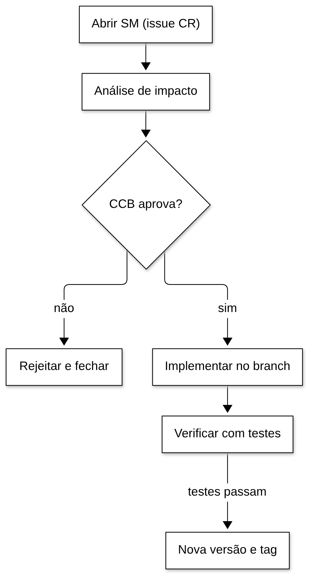

# DGD-GER-001 — Plano de Gerência de Configuração — DayGrid

Data: 18/11/2026

## 1. Identificação do documento

Este plano define como o projeto DayGrid identifica, controla, registra e audita seus itens de configuração até a entrega de 25/11/2026.

| Campo | Valor |
| --- | --- |
| ID do IC | DGD-GER-001 |
| Título | Plano de Gerência de Configuração (PGC) |
| Projeto | DayGrid — lista de afazeres diária |
| Versão | 1.1 (aprovada — baseline BL-PLAN, alterada pela SM-001) |
| Autor | Equipe DayGrid |
| Aprovação | CCB do projeto — ATA-002, 18/11/2026 |
| Norma de referência | IEEE 828 — Configuration Management in Systems and Software Engineering |

### Histórico de revisões

| Versão | Data | Autor | Descrição |
| --- | --- | --- | --- |
| 1.1 | 18/11/2026 | Equipe DayGrid | SM-001 (ATA-003): nova baseline BL-PROJ na seção 7; BL-IMPL passa a incluir as versões vigentes dos documentos técnicos |
| 1.0 | 18/11/2026 | Equipe DayGrid | Aprovado pelo CCB (ATA-002); entra na baseline BL-PLAN |
| 0.3 | 18/11/2026 | Equipe DayGrid | Horário do relatório semanal alinhado à ERS v0.5 (domingo às 23h59) |
| 0.2 | 18/11/2026 | Equipe DayGrid | Papéis e stack confirmados pela equipe; etiquetas passam a ser personalizáveis |
| 0.1 | 18/11/2026 | Equipe DayGrid | Criação do documento |

## 2. Introdução

### 2.1 Propósito

O PGC garante que todo artefato do DayGrid tenha identificação, versão, responsável e histórico. Depois que um item entra em uma baseline, ele só muda por meio de uma Solicitação de Mudança aprovada pelo CCB.

### 2.2 Escopo do sistema

O DayGrid é uma aplicação web de lista de afazeres diária. Ele permite que o usuário organize tarefas, receba lembretes por e-mail, acompanhe metas e consulte um relatório semanal de produtividade.

| Módulo | Responsabilidade |
| --- | --- |
| M0 — Usuários | Cadastro, login e isolamento dos dados de cada usuário |
| M1 — Tarefas | Status, prioridade, etiquetas personalizáveis e subtarefas |
| M2 — Lembretes | Alerta por data e hora, enviado por e-mail, com recorrência diária, semanal ou mensal |
| M3 — Metas | Objetivos com prazo e progresso calculado pelas tarefas vinculadas |
| M4 — Relatório semanal | Gerado todo domingo às 23h59 e exibido em uma tela do sistema |

### 2.3 Escopo da GC

Este plano cobre documentos de gerência, requisitos, arquitetura, código-fonte, scripts de banco, testes e releases. Ele vale do início do projeto (18/11/2026) até a entrega final (25/11/2026).

### 2.4 Termos

| Termo | Significado |
| --- | --- |
| IC | Item de Configuração: artefato controlado pela GC |
| Baseline | Conjunto de ICs aprovado em um marco, que só muda via SM |
| SM | Solicitação de Mudança (registrada como issue com rótulo `CR`) |
| CCB | Comitê de Controle de Configuração, que aprova ou rejeita as SMs |
| FCA / PCA | Auditoria Funcional / Auditoria Física de Configuração |

## 3. Organização e responsabilidades

A equipe tem quatro integrantes. Os papéis abaixo foram confirmados pela equipe em 18/11/2026.

| Integrante | Papel | Responsabilidades na GC |
| --- | --- | --- |
| Hugo Henry Lemos Carvalho | Gerente de Projeto e de Configuração | Mantém o PGC e a Lista de ICs, cria baselines e tags, conduz o CCB e as auditorias |
| Renata Martins da Silva | Analista de Requisitos | Mantém a ERS e a Matriz de Rastreabilidade, faz a análise de impacto das SMs de requisitos |
| João Vitor Simonetti | Desenvolvedor full-stack, DBA e DevOps | Implementa front-end, back-end e banco, mantém o pipeline de CI e os scripts de migração |
| Iago Medice Ferreira da Silva | Analista de Testes (QA) | Mantém o Plano e os Casos de Teste, executa os testes e fornece as evidências da auditoria funcional |

### 3.1 Comitê de Controle de Configuração (CCB)

- **Composição:** os quatro integrantes. Hugo preside e tem o voto de desempate.
- **Quórum:** pelo menos 3 integrantes.
- **Decisão:** maioria simples, registrada na própria issue da SM e na ata.
- **Reuniões:** sempre que houver uma SM aberta. Uma SM urgente pode ser decidida em até 24 horas, pelo grupo da equipe.

## 4. Ferramentas e ambiente

A stack, confirmada pela equipe em 18/11/2026, parte do que a equipe já domina: uma aplicação web com back-end em Python/Flask e banco MySQL.

| Finalidade | Ferramenta |
| --- | --- |
| Controle de versão e repositório | Git + GitHub |
| Solicitações de mudança e tarefas | GitHub Issues (rótulos `CR`, `bug`, `feat`, `docs`) + GitHub Projects |
| Integração contínua | GitHub Actions (lint + testes a cada pull request) |
| Front-end | HTML, CSS e JavaScript |
| Back-end | Python 3 + Flask |
| Banco de dados | MySQL, com migrações versionadas |
| Envio de e-mail (lembretes) | SMTP pelo back-end |
| Agendamento (lembretes e relatório de domingo) | Agendador de tarefas no back-end (por exemplo, APScheduler) |
| Testes | pytest (unitários e de integração) + Postman (API) |
| Documentação | Claude Docs (documentos) e planilha da Lista de ICs |

A biblioteca de agendamento e o provedor de SMTP serão definidos no Documento de Arquitetura (DGD-ARQ-001).

## 5. Identificação de configuração

### 5.1 Critérios para um artefato virar IC

Um artefato vira IC quando atende a pelo menos um destes critérios:

- é entregue ao professor ou ao usuário;
- é usado por outro integrante para produzir o próprio trabalho;
- uma mudança nele afeta requisitos, código, banco ou testes;
- é necessário para reconstruir uma versão do sistema.

Arquivos temporários, rascunhos pessoais e arquivos gerados no build (como `__pycache__` e `.env`) não são ICs.

### 5.2 Nomenclatura

Formato: `DGD-<TIPO>-<NNN>`, com numeração sequencial por tipo. Exemplo: `DGD-REQ-001`.

| Tipo | Significado |
| --- | --- |
| GER | Gerência (planos, registros, relatórios) |
| REQ | Requisitos |
| ARQ | Arquitetura e projeto |
| BD | Banco de dados (modelo e migrações) |
| COD | Código-fonte |
| TST | Testes |
| REL | Releases |

### 5.3 Versionamento

- **Documentos:** `0.x` enquanto estão em rascunho; `1.0` quando entram em uma baseline; `1.1`, `1.2`… a cada SM aprovada; `2.0` para uma reestruturação completa.
- **Software:** SemVer `MAJOR.MINOR.PATCH`. `MINOR` sobe com uma funcionalidade nova, `PATCH` com uma correção, e `1.0.0` é a entrega final.
- **Requisitos:** `RF01`, `RF02`… (funcionais), `RNF01`… (não funcionais) e `RN01`… (regras de negócio). Um ID nunca é reaproveitado: requisito removido fica marcado como *cancelado*.

### 5.4 ICs iniciais

O inventário completo, com versão, responsável e status de cada item, fica na Lista de Itens de Configuração (DGD-GER-002).

| ID | Item | Responsável |
| --- | --- | --- |
| DGD-GER-001 | Plano de Gerência de Configuração | Hugo |
| DGD-GER-002 | Lista de Itens de Configuração | Hugo |
| DGD-GER-003 | Registro de SMs e Atas do CCB | Hugo |
| DGD-GER-004 | Relatório de Status da Configuração | Hugo |
| DGD-GER-005 | Relatório de Auditoria de Configuração | Hugo e Iago |
| DGD-REQ-001 | Especificação de Requisitos de Software (ERS) | Renata |
| DGD-REQ-002 | Matriz de Rastreabilidade | Renata |
| DGD-ARQ-001 | Documento de Arquitetura | João Vitor |
| DGD-BD-001 | Modelo de dados e scripts de migração | João Vitor |
| DGD-COD-001 | Código-fonte do front-end | João Vitor |
| DGD-COD-002 | Código-fonte do back-end | João Vitor |
| DGD-TST-001 | Plano e Casos de Teste | Iago |
| DGD-REL-001 | Notas de Release | Hugo |

## 6. Repositório, branches e commits

### 6.1 Estrutura do repositório

Um único repositório GitHub (`daygrid`) guarda o código e uma cópia exportada de cada documento aprovado.

```
daygrid/
├── docs/
│   ├── gerencia/     # DGD-GER-*
│   ├── requisitos/   # DGD-REQ-*
│   └── arquitetura/  # DGD-ARQ-*
├── frontend/         # DGD-COD-001
├── backend/          # DGD-COD-002
│   └── app/
├── database/
│   └── migrations/   # DGD-BD-001
├── tests/            # DGD-TST-001
├── .github/workflows/
├── CHANGELOG.md      # DGD-REL-001
└── README.md
```

### 6.2 Estratégia de branches

O projeto usa GitHub Flow: `main` protegida e branches curtos, um por issue.

- `main`: sempre estável. Não aceita push direto, só merge via pull request com 1 aprovação e CI verde.
- Branches de trabalho: `<tipo>/<id-issue>-<descricao>`, com tipo `feat`, `fix`, `docs`, `test` ou `chore`. Exemplos: `feat/12-cadastro-tarefa`, `fix/27-lembrete-duplicado`.
- Cada branch é apagado depois do merge.

### 6.3 Padrão de commits

Commits seguem Conventional Commits e citam a issue: `feat(tarefas): adiciona subtarefas (#12)`. Uma mudança que vem de uma SM cita também o ID dela: `fix(metas): recalcula progresso (#31, SM-003)`.

### 6.4 Tags

Toda baseline e toda release recebem uma tag anotada em `main`, com o mesmo nome da baseline ou da versão (por exemplo, `BL-REQ` ou `v1.0.0`).

## 7. Baselines planejadas

Cinco baselines levam o projeto até a entrega de 25/11/2026. O cronograma é curto (7 dias), por isso cada baseline depende da aprovação da anterior. A BL-PROJ foi incluída pela SM-001 (ATA-003) para congelar os documentos técnicos antes do código.

| Baseline | Data prevista | ICs incluídos | Critério de aprovação |
| --- | --- | --- | --- |
| BL-PLAN | 19/11/2026 | DGD-GER-001, DGD-GER-002 | Papéis confirmados e PGC revisado pela equipe |
| BL-REQ | 20/11/2026 | DGD-REQ-001, DGD-REQ-002 | ERS revisada e aprovada pelo CCB, cada RF com critério de aceitação |
| BL-PROJ | 21/11/2026 | DGD-ARQ-001, DGD-BD-001, DGD-TST-001 | Documentos técnicos revisados pela equipe, consistentes com a BL-REQ e aprovados pelo CCB |
| BL-IMPL | 24/11/2026 | DGD-COD-001, DGD-COD-002 e as versões vigentes de DGD-ARQ-001, DGD-BD-001 e DGD-TST-001 | CI verde, testes de RF passando e rastreabilidade atualizada |
| BL-REL | 25/11/2026 | Todos os ICs + DGD-REL-001 | Auditorias FCA e PCA aprovadas; tag `v1.0.0` |

Cada baseline gera uma tag em `main`, uma entrada no Relatório de Status e a versão `1.0` (ou superior) dos documentos incluídos.

## 8. Controle de mudanças

Antes da baseline, um IC muda livremente dentro da versão `0.x`. Depois da baseline, toda alteração exige uma Solicitação de Mudança (SM) aprovada pelo CCB.



Se a SM for rejeitada, o motivo fica registrado e a issue é fechada. Se for aprovada, a mudança segue o fluxo normal de branch e pull request e termina com uma nova versão do IC.

### 8.1 Etapas

1. **Abrir a SM:** qualquer integrante abre uma issue com o rótulo `CR` e o ID `SM-NNN` no título.
2. **Analisar o impacto:** o responsável pelo IC afetado estima esforço, risco, prazo e quais ICs e requisitos são atingidos (usando a Matriz de Rastreabilidade).
3. **Decidir no CCB:** a decisão (aprovada, rejeitada ou adiada) e a justificativa são registradas na issue e no Registro de SMs (DGD-GER-003).
4. **Implementar:** a mudança é feita em um branch próprio, e os commits citam a SM.
5. **Verificar:** o QA executa os testes afetados antes do merge.
6. **Fechar:** a versão do IC sobe, a Lista de ICs e o Relatório de Status são atualizados e a issue é fechada.

### 8.2 Campos obrigatórios da SM

| Campo | Conteúdo |
| --- | --- |
| ID | SM-NNN (sequencial) |
| Solicitante e data | Quem pediu e quando |
| Descrição | O que deve mudar |
| Justificativa | Por que deve mudar |
| ICs afetados | IDs e versões atuais |
| Prioridade | Baixa, média ou alta |
| Análise de impacto | Esforço, risco, prazo e requisitos atingidos |
| Decisão do CCB | Aprovada, rejeitada ou adiada + justificativa + data |
| Status | Aberta → Em análise → Aprovada ou Rejeitada → Implementada → Verificada → Fechada |

## 9. Relato de status e auditorias

### 9.1 Relatório de Status da Configuração (DGD-GER-004)

O gerente de configuração atualiza o relatório a cada baseline e a cada SM fechada. Ele registra:

- a versão atual de cada IC e a baseline a que pertence;
- as SMs abertas, aprovadas, rejeitadas e fechadas no período;
- o que mudou entre a versão anterior e a atual;
- as pendências que bloqueiam a próxima baseline.

### 9.2 Auditorias (DGD-GER-005)

| Auditoria | Quando | O que verifica | Responsáveis |
| --- | --- | --- | --- |
| Auditoria Funcional (FCA) | Antes da BL-REL, em 25/11/2026 | Cada RF da ERS tem caso de teste executado e aprovado, conforme a Matriz de Rastreabilidade | Iago e Renata |
| Auditoria Física (PCA) | Antes da BL-REL, em 25/11/2026 | Os arquivos da tag `v1.0.0` correspondem aos ICs e versões da Lista de ICs; documentos aprovados estão em `docs/` | Hugo e João Vitor |

Uma não conformidade encontrada na auditoria vira uma SM ou um bug. A BL-REL só é criada quando não há não conformidade de prioridade alta em aberto.

## 10. Releases e pendências

### 10.1 Releases

Cada release recebe uma tag SemVer em `main` e uma entrada no `CHANGELOG.md` (DGD-REL-001) com: versão, data, funcionalidades novas, correções, SMs incluídas, problemas conhecidos e instruções de instalação. A entrega final é a `v1.0.0`, em 25/11/2026.

### 10.2 Pendências para a BL-PLAN

- [x] Equipe confirmar os papéis da seção 3
- [x] Equipe confirmar a stack da seção 4 (web com Flask + MySQL)
- [ ] Criar o repositório `daygrid` no GitHub e proteger `main`
- [ ] Informar a disciplina e o professor para a identificação do documento
