# ESPECIFICAÇÃO DE REQUISITOS DE SOFTWARE (ERS): DayGrid

Item de configuração DGD-REQ-003, versão 1.0, baseline BL-PROJ. Responsáveis: Renata Martins da Silva (Analista de Requisitos) e João Vitor Simonetti (Desenvolvedor full-stack, DBA e DevOps). Documentos de base: DGD-REQ-001 (Documento de Requisitos) v1.2, DGD-ARQ-001 (Arquitetura) v1.2 e DGD-BD-001 (Modelo de Dados) v1.2.

| Data | Versão | Descrição | Responsável |
| --- | --- | --- | --- |
| 19/11/2026 | 1.0 | Criação no template da disciplina, a partir do Documento de Requisitos, da Arquitetura e do Modelo de Dados; aprovada pelo CCB (SM-003, ATA-005) e incluída na BL-PROJ | Renata Martins da Silva e João Vitor Simonetti |

## 1. Introdução

Esta especificação descreve como o DayGrid atende aos requisitos do Documento de Requisitos (DGD-REQ-001): a arquitetura geral, os casos de uso, as classes, a estrutura do banco de dados, as regras de validação, as interfaces e a API REST. Ela é destinada à equipe de desenvolvimento e de testes.

Os requisitos citados (RFxx, RNxx e RNFxx) são os do Documento de Requisitos. O detalhamento técnico completo continua no Documento de Arquitetura (DGD-ARQ-001) e no Modelo de Dados (DGD-BD-001); quando houver divergência, valem esses documentos e esta ERS deve ser corrigida por Solicitação de Mudança.

## 2. Arquitetura Geral do Sistema

O DayGrid é uma aplicação web em três camadas. O navegador carrega o front-end estático, servido pelo próprio Flask, e conversa com a API REST em JSON. A API e o agendador usam a mesma camada de serviços, onde ficam todas as regras de negócio. Os dados ficam no MySQL, e os e-mails saem pelo SMTP do Gmail.

Diagrama de pacotes:

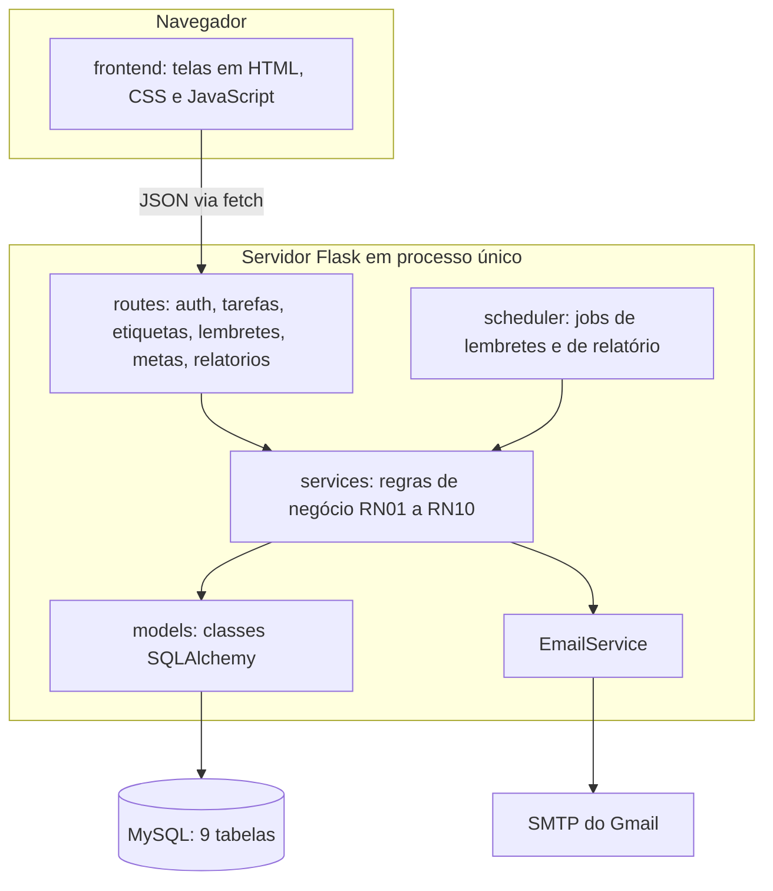

| Pacote | Conteúdo | Componentes (DGD-ARQ-001) |
| --- | --- | --- |
| `frontend` | Telas, chamadas à API e layout responsivo | CMP-09 |
| `routes` | Um blueprint Flask por módulo (M0 a M4) | CMP-01 a CMP-06 |
| `services` | Regras de negócio, usadas pelas rotas e pelo agendador | CMP-01 a CMP-07 |
| `models` | Classes que representam as tabelas do banco | Todos |
| `scheduler` | Jobs `enviar_lembretes` (a cada minuto) e `gerar_relatorios` (domingo às 23h59) | CMP-08 |

### 2.1 Arquitetura de Camadas

Toda requisição passa por três camadas, nesta ordem (DA-03):

1. Rotas (`routes/`): recebem o HTTP, validam o formato do JSON, exigem login e devolvem a resposta com o código de status. Não têm regra de negócio.
2. Serviços (`services/`): aplicam as regras de negócio (RN01 a RN10) e as regras de validação da seção 6, e coordenam os modelos. São chamados pelas rotas e pelo agendador.
3. Modelos (`models/`): classes SQLAlchemy que representam as tabelas do MySQL. Toda consulta filtra pelo usuário logado (DA-06).

O agendador (APScheduler) roda no mesmo processo do Flask, que por isso executa em um único processo, para que o mesmo lembrete não seja enviado duas vezes (DA-07).

## 3. Modelo de Casos de Uso

O sistema tem dois atores. O usuário cadastrado é o ator principal e gerencia apenas os próprios dados. O agendador do sistema é um ator secundário, que dispara os lembretes e gera o relatório semanal sem ação do usuário.

### 3.1 Detalhados

| ID | ATOR | DESCRIÇÃO |
| --- | --- | --- |
| UC1 | Usuário | Manter conta: cadastrar-se, entrar, sair e redefinir a senha por um link enviado ao e-mail (RF01 a RF04) |
| UC2 | Usuário | Manter tarefas: criar, editar, excluir, alterar o status e remarcar tarefas, ver a lista do dia e filtrar a lista (RF05 a RF08, RF10 a RF12) |
| UC3 | Usuário | Manter subtarefas: adicionar, marcar como concluída e remover subtarefas de uma tarefa (RF09) |
| UC4 | Usuário | Manter etiquetas: criar, renomear e excluir etiquetas, escolhendo uma substituta quando a etiqueta está em uso (RF25) |
| UC5 | Usuário | Manter lembretes: criar, editar e excluir lembretes, vinculados a uma tarefa ou independentes, com ou sem recorrência (RF13, RF14, RF16) |
| UC6 | Agendador do sistema | Enviar lembretes: enviar por e-mail os lembretes vencidos e agendar a próxima ocorrência dos recorrentes (RF15) |
| UC7 | Usuário | Manter metas: criar, editar e excluir metas, vincular e desvincular tarefas e acompanhar a barra de progresso (RF17 a RF20) |
| UC8 | Agendador do sistema | Gerar relatório semanal: calcular e gravar todo domingo às 23h59 o relatório da semana de cada usuário (RF21) |
| UC9 | Usuário | Consultar relatórios: ver os percentuais de concluídas e adiadas, os dias mais produtivos e o progresso das metas de cada semana (RF22 a RF24) |

| ID | Pré-condição | Fluxo principal | Exceções |
| --- | --- | --- | --- |
| UC1 | Nenhuma para cadastro, login e redefinição; sessão aberta para sair | O usuário informa nome, e-mail e senha; o sistema cria a conta com as três etiquetas iniciais e abre a tela inicial | E-mail já cadastrado; credenciais inválidas; link de redefinição vencido (15 minutos) ou já usado |
| UC2 | Usuário logado | O usuário cria a tarefa com título, data prevista, prioridade e etiqueta; a tarefa aparece na lista com status Pendente | Campo obrigatório vazio; etiqueta inexistente; status inválido |
| UC3 | Tarefa existente | O usuário adiciona subtarefas e as marca como concluídas; a tarefa mostra quantas foram concluídas | Subtarefa sem título |
| UC4 | Usuário logado | O usuário cria ou renomeia uma etiqueta; ao excluir uma etiqueta em uso, escolhe a substituta | Nome repetido; exclusão de etiqueta em uso sem substituta |
| UC5 | Usuário logado | O usuário informa título, data, horário, recorrência e, se quiser, a tarefa; o sistema mostra a data do próximo envio | Data e horário no passado |
| UC6 | Lembrete ativo com envio vencido | A cada minuto, o agendador envia o e-mail e agenda a próxima ocorrência | Lembrete vinculado a tarefa já concluída não é enviado (RN08) |
| UC7 | Usuário logado | O usuário cria a meta com título e prazo e vincula tarefas; a barra de progresso é calculada a cada consulta | Tarefa já vinculada a outra meta (RN07) |
| UC8 | Domingo às 23h59 (America/Manaus) | O agendador calcula e grava o relatório da semana de segunda a domingo de cada usuário | Semana sem tarefas gera percentuais zerados |
| UC9 | Usuário logado e relatório já gerado | O usuário escolhe a semana e vê os percentuais, os dias mais produtivos e o progresso das metas | Nenhum relatório gerado ainda |

### 3.2 Diagramas de Caso de Uso

Visão geral:

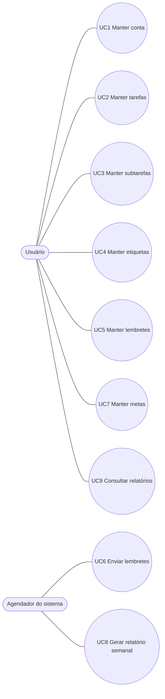

UC1: Manter conta

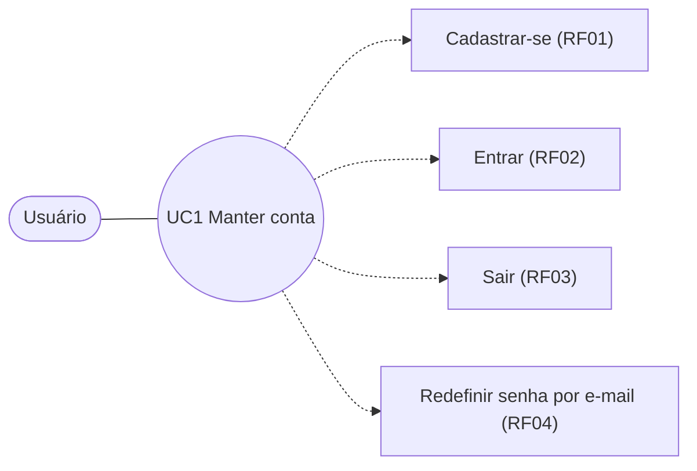

UC2: Manter tarefas

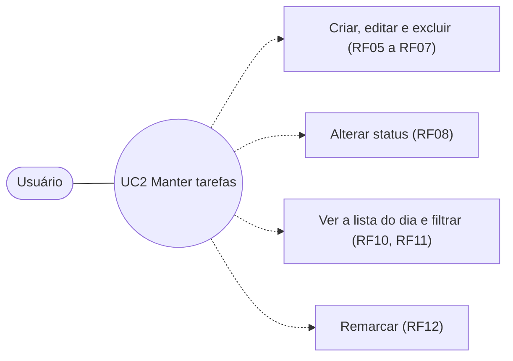

UC3: Manter subtarefas

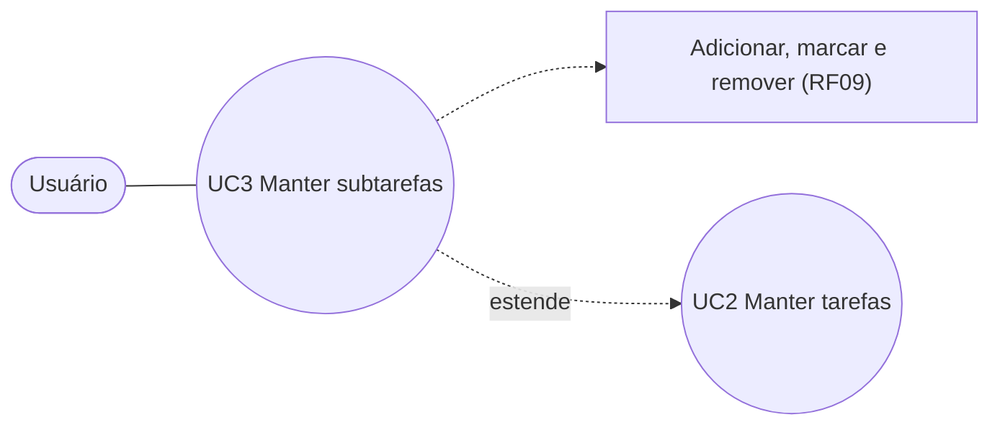

UC4: Manter etiquetas

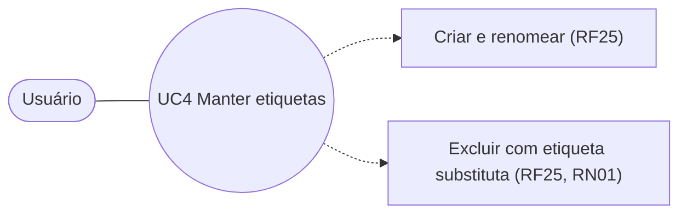

UC5: Manter lembretes

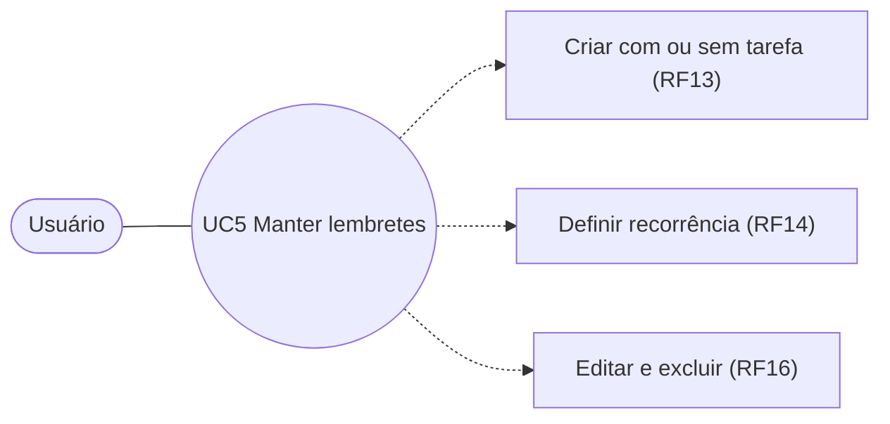

UC6: Enviar lembretes

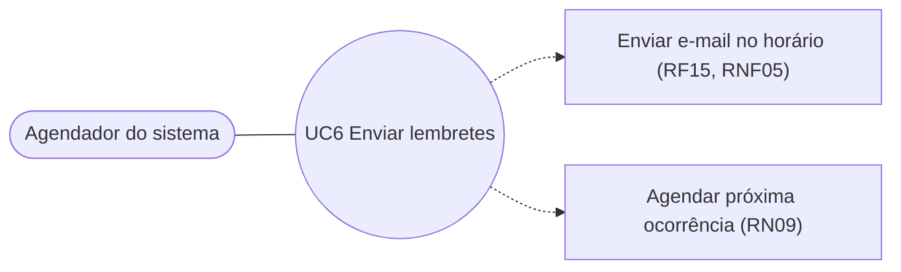

UC7: Manter metas

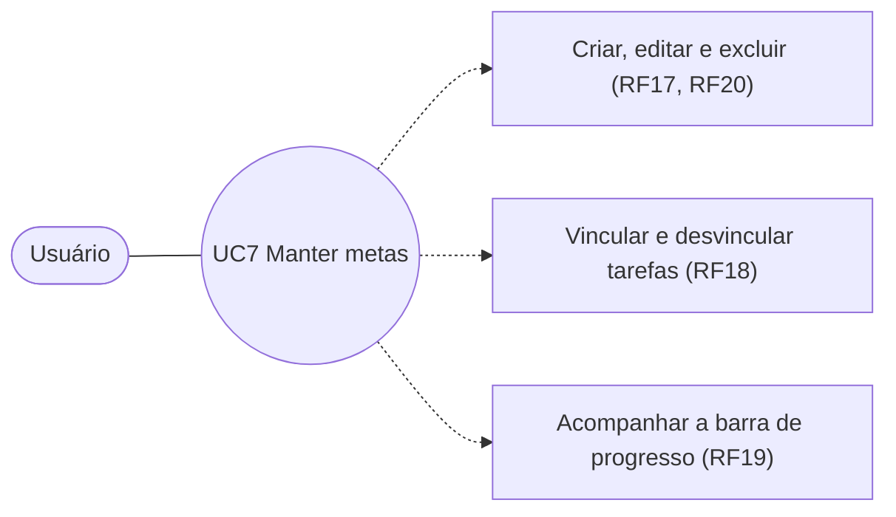

UC8: Gerar relatório semanal

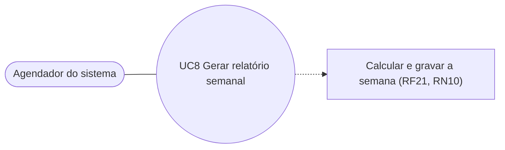

UC9: Consultar relatórios

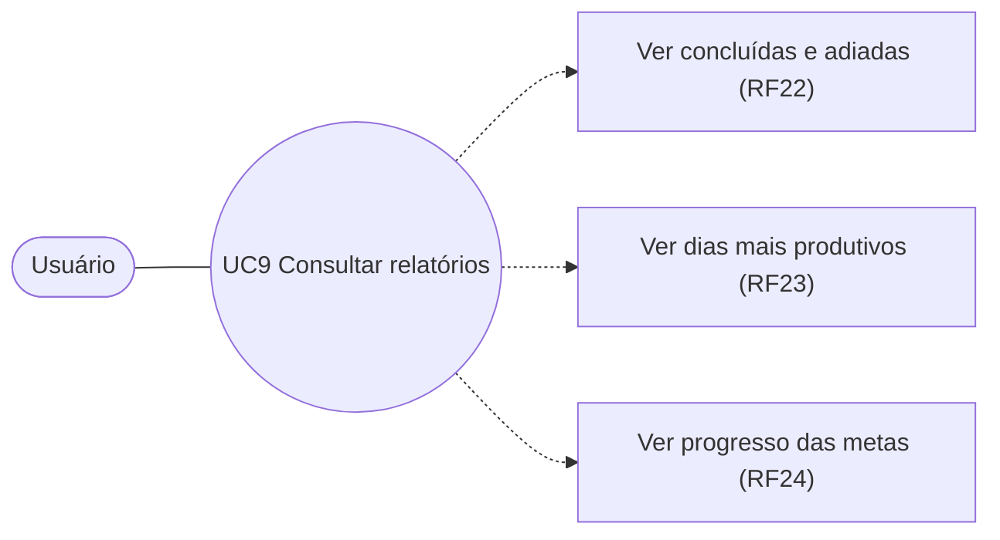

## 4. Diagrama de Classes (descrição)

O domínio tem nove classes, uma para cada tabela do Modelo de Dados. A classe `Tarefa` é o centro do modelo. As regras de negócio ficam nos serviços (`AuthService`, `TarefaService`, `EtiquetaService`, `LembreteService`, `MetaService`, `RelatorioService` e `EmailService`), que usam estas classes.

| Classe | Responsabilidade | Relações |
| --- | --- | --- |
| `Usuario` | Dados de acesso do usuário, com a senha só como hash bcrypt (RNF03) | Possui etiquetas, tarefas, lembretes, metas, relatórios e tokens de redefinição |
| `Etiqueta` | Classificação das tarefas; nome único por usuário (RN01) | Pertence a um usuário; usada por várias tarefas |
| `Tarefa` | Título, descrição, data prevista, prioridade e status (RN02, RN03) | Tem uma etiqueta, no máximo uma meta (RN07), várias subtarefas, remarcações e lembretes |
| `Subtarefa` | Item de checklist da tarefa, sem efeito em metas e relatório (RN05) | Pertence a uma tarefa e é excluída com ela |
| `Remarcacao` | Histórico de cada adiamento, com a data anterior e a nova (RN04) | Pertence a uma tarefa |
| `Lembrete` | Título, próximo envio, recorrência e dia de referência (RN08, RN09) | Pertence a um usuário; pode estar vinculado a uma tarefa |
| `Meta` | Título, descrição e prazo; o progresso é calculado a cada consulta (RN06) | Pertence a um usuário; agrupa várias tarefas |
| `RelatorioSemanal` | Resultado já calculado da semana de segunda a domingo (RN10) | Pertence a um usuário |
| `TokenRedefinicao` | Token de uso único, válido por 15 minutos (RF04) | Pertence a um usuário |

### 4.1 Diagrama de Classe (gráfico)

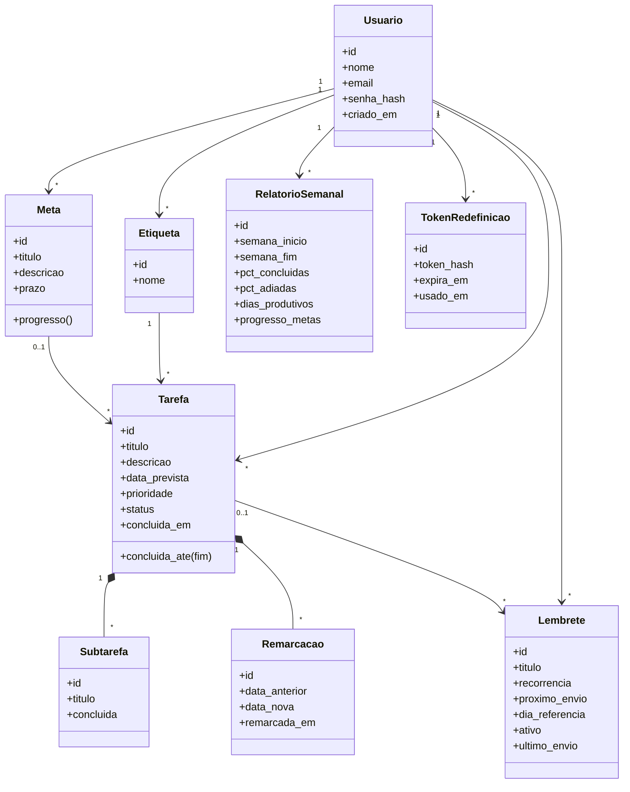

## 5. Estrutura do Banco de Dados (modelo lógico simplificado)

Notação: a chave primária vem primeiro; FK indica chave estrangeira. Tipos, tamanhos, índices e ações de exclusão estão no Modelo de Dados (DGD-BD-001).

| Tabela | Colunas | Chaves e restrições principais |
| --- | --- | --- |
| `usuario` | id, nome, email, senha_hash, criado_em | email único |
| `etiqueta` | id, usuario_id, nome, criado_em | FK usuario; nome único por usuário |
| `meta` | id, usuario_id, titulo, descricao, prazo, criado_em | FK usuario |
| `tarefa` | id, usuario_id, etiqueta_id, meta_id, titulo, descricao, data_prevista, prioridade, status, concluida_em, criado_em, atualizado_em | FK usuario; FK etiqueta (obrigatória); FK meta (opcional) |
| `subtarefa` | id, tarefa_id, titulo, concluida, criado_em | FK tarefa (excluída com a tarefa) |
| `remarcacao` | id, tarefa_id, data_anterior, data_nova, remarcada_em | FK tarefa; data nova posterior à anterior |
| `lembrete` | id, usuario_id, tarefa_id, titulo, recorrencia, proximo_envio, dia_referencia, ativo, ultimo_envio, criado_em | FK usuario; FK tarefa (opcional) |
| `relatorio_semanal` | id, usuario_id, semana_inicio, semana_fim, total_tarefas, total_concluidas, total_adiadas, pct_concluidas, pct_adiadas, dias_produtivos, progresso_metas, gerado_em | FK usuario; um relatório por usuário e semana |
| `token_redefinicao` | id, usuario_id, token_hash, expira_em, usado_em, criado_em | FK usuario; token_hash único |

## 6. Regras de Validação

As validações são feitas na camada de serviços e repetidas no banco quando ele consegue garanti-las. As respostas usam os códigos HTTP da seção 8.

| ID | Situação | Regra | Resposta | Origem |
| --- | --- | --- | --- | --- |
| RV01 | Cadastro | Nome (até 100 caracteres), e-mail (até 255) e senha são obrigatórios | 400 | RF01 |
| RV02 | Cadastro | O e-mail não pode estar cadastrado | 409 | RF01 |
| RV03 | Login | Credenciais erradas geram mensagem genérica, sem dizer qual campo está errado | 401 | RF02 |
| RV04 | Redefinição de senha | O token vale por 15 minutos e só pode ser usado uma vez | 400 | RF04 |
| RV05 | Tarefa | Título (até 120 caracteres), data prevista e etiqueta do próprio usuário são obrigatórios | 400 | RF05, RN01 |
| RV06 | Tarefa | Prioridade deve ser Baixa, Média ou Alta; sem escolha, vale Média | 400 | RN03 |
| RV07 | Tarefa | Status deve ser Pendente, Em andamento ou Concluída; toda tarefa nasce Pendente | 400 | RN02, RF08 |
| RV08 | Remarcação | A remarcação para uma data posterior fica registrada e marca a tarefa como adiada | Não se aplica | RF12, RN04 |
| RV09 | Etiqueta | Nome (até 40 caracteres) é obrigatório e não pode repetir entre as etiquetas do usuário | 400 ou 409 | RF25, RN01 |
| RV10 | Exclusão de etiqueta | Etiqueta em uso só é excluída com a indicação de uma etiqueta substituta | 400 | RF25, RN01 |
| RV11 | Lembrete | Título (até 120 caracteres) é obrigatório, a data e o horário não podem estar no passado e a recorrência deve ser nenhuma, diária, semanal ou mensal | 400 | RF13, RF14 |
| RV12 | Meta | Título (até 120 caracteres) e prazo são obrigatórios | 400 | RF17 |
| RV13 | Vínculo com meta | Uma tarefa já vinculada a outra meta não pode ser vinculada | 409 | RF18, RN07 |
| RV14 | Acesso | Rotas protegidas exigem sessão aberta | 401 | RF02, RF03 |
| RV15 | Acesso | Recurso de outro usuário é tratado como inexistente | 404 | RNF04 |

## 7. Requisitos de Interface

Requisitos gerais: a interface funciona nas versões atuais do Chrome, Firefox e Edge (RNF01), é responsiva para desktop e celular (RNF02), usa português do Brasil, datas no formato dd/mm/aaaa e horários no fuso America/Manaus (RNF07). As mensagens de erro das validações da seção 6 aparecem junto ao formulário, sem perder o que o usuário digitou.

| Tela ou interface | Conteúdo | Requisitos |
| --- | --- | --- |
| Login e cadastro (`index.html`) | Formulários de login e cadastro e link para redefinir a senha | RF01 a RF04 |
| Tarefas | Lista do dia ordenada por prioridade, filtros por status, prioridade e etiqueta, formulário de tarefa e subtarefas com contador (ex.: 2/5) | RF05 a RF12 |
| Etiquetas | Lista das etiquetas do usuário, criação, renomeação e exclusão com escolha da substituta | RF25 |
| Lembretes | Lista com a data do próximo envio e formulário com data, horário, recorrência e tarefa opcional | RF13, RF14, RF16 |
| Metas | Lista de metas com barra de progresso, formulário da meta e vínculo de tarefas | RF17 a RF20 |
| Relatórios | Lista das semanas geradas e detalhe com percentuais, dias mais produtivos e progresso das metas | RF21 a RF24 |
| E-mail de lembrete | Título do lembrete e, se houver, o da tarefa vinculada | RF15 |
| E-mail de redefinição | Link de uso único, válido por 15 minutos | RF04 |
| API REST | JSON sobre HTTP, conforme a seção 8 | Todos os RF |

## 8. Requisitos de API REST

Todas as rotas ficam sob `/api`, recebem e devolvem JSON e, exceto cadastro, login e redefinição de senha, exigem login. Códigos de resposta: `200` ok, `201` criado, `204` sem conteúdo, `400` dado inválido, `401` sem login, `404` não encontrado (inclusive recurso de outro usuário) e `409` conflito. O envio de lembretes (RF15) e a geração do relatório (RF21) não têm rota: são feitos pelo agendador.

| Método | Rota | Ação | RF |
| --- | --- | --- | --- |
| POST | `/api/auth/cadastro` | Cria o usuário e as três etiquetas iniciais | RF01 |
| POST | `/api/auth/login` | Abre a sessão | RF02 |
| POST | `/api/auth/logout` | Encerra a sessão | RF03 |
| POST | `/api/auth/esqueci-senha` | Envia o link de redefinição por e-mail | RF04 |
| POST | `/api/auth/redefinir-senha` | Troca a senha usando o token do link | RF04 |
| GET | `/api/tarefas?data=&status=&prioridade=&etiqueta=` | Lista as tarefas; sem filtros, traz as do dia ordenadas por prioridade | RF10, RF11 |
| POST | `/api/tarefas` | Cria uma tarefa | RF05 |
| PUT | `/api/tarefas/<id>` | Edita a tarefa, inclusive a data prevista | RF06, RF12 |
| DELETE | `/api/tarefas/<id>` | Exclui a tarefa, com subtarefas e lembretes | RF07 |
| PATCH | `/api/tarefas/<id>/status` | Altera o status | RF08 |
| POST | `/api/tarefas/<id>/subtarefas` | Adiciona uma subtarefa | RF09 |
| PATCH | `/api/tarefas/<id>/subtarefas/<sid>` | Marca ou desmarca a subtarefa | RF09 |
| DELETE | `/api/tarefas/<id>/subtarefas/<sid>` | Remove a subtarefa | RF09 |
| GET | `/api/etiquetas` | Lista as etiquetas do usuário | RF25 |
| POST | `/api/etiquetas` | Cria uma etiqueta | RF25 |
| PUT | `/api/etiquetas/<id>` | Renomeia a etiqueta | RF25 |
| DELETE | `/api/etiquetas/<id>?substituta=<id>` | Exclui a etiqueta; se estiver em uso, `substituta` é obrigatória | RF25 |
| GET | `/api/lembretes` | Lista os lembretes, com a data do próximo envio | RF14 |
| POST | `/api/lembretes` | Cria um lembrete, com ou sem tarefa e recorrência | RF13, RF14 |
| PUT | `/api/lembretes/<id>` | Edita o lembrete | RF16 |
| DELETE | `/api/lembretes/<id>` | Exclui o lembrete | RF16 |
| GET | `/api/metas` | Lista as metas com o progresso calculado | RF19 |
| POST | `/api/metas` | Cria uma meta | RF17 |
| PUT | `/api/metas/<id>` | Edita a meta | RF20 |
| DELETE | `/api/metas/<id>` | Exclui a meta; as tarefas ficam sem meta | RF20 |
| POST | `/api/metas/<id>/tarefas/<tid>` | Vincula a tarefa; se ela já estiver em outra meta, responde 409 | RF18 |
| DELETE | `/api/metas/<id>/tarefas/<tid>` | Desvincula a tarefa | RF18 |
| GET | `/api/relatorios` | Lista os relatórios das semanas já geradas | RF21 |
| GET | `/api/relatorios/<id>` | Mostra percentuais, dias mais produtivos e progresso das metas | RF22, RF23, RF24 |

